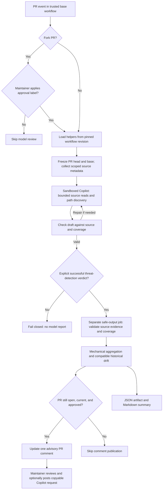

# PR slop assessment

An experimental **GitHub Agentic Workflow** for reviewing avoidable code-quality
debt in pull requests, regardless of who wrote the code.

This concept is intended to support human PR review by highlighting potentially
sloppy changes before they are merged, not to replace a reviewer's judgement.
It uses an **LLM-as-a-judge** approach: Copilot assesses the changes against a
defined rubric and proposes findings and category scores. The workflow validates
the evidence and calculates the overall index mechanically. The result is
advisory and may miss issues or raise false positives.

The assessment targets eligible files changed by the PR, not the repository as
a whole. Copilot may read unchanged code and existing utilities for context, but
findings must cite a head-side PR diff hunk; those hunks can include unchanged
context lines. Deleted files are excluded from assessment.

Scores range from **0 (no supported issues found) to 100 (worst)**. They are
rubric-based indices, not percentages of AI-generated or defective code.
[SPEC.md](SPEC.md) records the approved product design.

## Pipeline



1. **Runtime** loads helpers from the same pinned revision as the reusable
   workflow. The caller does not check out or execute PR code.
2. **Inventory** queries the GitHub API using those trusted helpers. It
   freezes the PR head/base, lists changes and exclusions, and retrieves
   available report history. It never checks out or runs proposed code.
3. **Analysis** uses gh-aw's native Copilot engine.
   The judge gets only custom path-discovery, source-range, and context tools,
   with shell, editing, built-in GitHub tools, and general outbound access disabled.
   Source-byte reservations and read coverage use shared, atomic state across
   MCP subprocesses; unique source snapshots share a one-megabyte review budget,
   separate from the inventory budget.
4. **Validation** checks a draft before submission and again in a separate
   publishing job. Exact excerpts must match immutable source ranges (with CRLF
   line endings normalised), findings must overlap changed code, and reviewed
   modules must have been fully read.
   Missed reuse also requires a base utility and compatibility explanation.
5. **Scoring** averages available non-drift families only when at least three
   are assessable. Missing evidence is N/A, never a clean score. Compatible prior
   report artifacts provide per-family drift.
6. **Publication** rechecks the open PR head/base and updates one bot-authored report
   comment. Artifacts and summaries remain available when comments cannot be
   posted. Human-readable reports include a copyable, non-automatic Copilot
   feedback request where appropriate.

## Scoring and evidence

| Family          | What is reviewed                                                       |
| --------------- | ---------------------------------------------------------------------- |
| Redundancy      | Duplicated behaviour, compatible utilities missed, avoidable wrappers  |
| Complexity      | Changed control flow, nesting, coupling, brittleness                   |
| Maintainability | Abstractions, conventions, unnecessary dependencies                    |
| Correctness     | Supplied build, type-check, or test evidence                           |
| Reliability     | Changed error paths and trust boundaries; not a security certification |
| Revision drift  | Compatible historical score deltas, separate from the overall index    |

Category scores use only **0, 25, 50, 75, 100**, with evidence-based explanations.
Medium/low-confidence observations do not penalise scores. High-confidence
findings remain visible even if a low overall average would hide them.
An assessed category cannot score below the severity of a high-confidence finding.

Generated/vendor/binary/minified/lockfile content is excluded by default.
Tests, dependency manifests, and infrastructure-as-code are eligible.
Documentation is context. Sensitive filenames and known credential patterns
receive additional filtering; this is not a guarantee of perfect secret detection.

The inventory also reports conservative exact eight-line duplicate candidates
among up to twenty changed modules. Candidates are **not scored**. The reusable
workflow does not currently accept execution evidence, so correctness is N/A.
Without enough assessable families there is no overall index.

## Install the reusable workflow

The reusable workflow runs as a **job**, not as a step-level action. It requires
GitHub.com Actions, runner version 2.336.0 or later, and a Copilot-enabled
account. The consuming repository must be able to access this repository and
its Actions policy must permit the referenced workflows and actions.

Once the workflow is released and accessible to your repository, pin it to the
release's immutable commit SHA. See [releases](docs/releases.md).

### Choose authentication

| Your setup                                                                             | How to run the reusable workflow                                                                                                                            |
| -------------------------------------------------------------------------------------- | ----------------------------------------------------------------------------------------------------------------------------------------------------------- |
| A user has an organisation-provided Copilot seat                                       | Use that user's fine-grained PAT. Confirm the account's entitlement, usage limits and billing with your organisation.                                       |
| Central organisation billing is unavailable, but a user has their own Copilot access   | Use that user's fine-grained PAT. Usage follows that account's plan and billing settings.                                                                   |
| You want organisation-billed inference using the Actions `GITHUB_TOKEN`, without a PAT | The published workflow does not support this directly. See the [custom organisation-billed configuration](#organisation-billed-actions-token-custom-build). |
| No user has Copilot access                                                             | The reusable model workflow cannot run.                                                                                                                     |

The PAT authenticates **model inference**. The workflow uses the separate,
short-lived Actions `GITHUB_TOKEN` for repository reads and the PR comment.
Never put a PAT in a workflow file, PR, or commit.

GitHub Agentic Workflows also supports
[organisation-billed inference without a PAT](https://github.github.com/gh-aw/reference/auth/#copilot-requests-write-permission)
when configured and compiled for `copilot-requests: write`. That is a different
authentication mode from this reusable workflow; it requires an eligible
organisation subscription and policy, and is not enabled by this release.

### Organisation-billed Actions token (custom build)

The shipped reusable workflow requires a PAT. To use the organisation's
Actions token instead, maintain an organisation-controlled copy of the complete
repository and configure **both** reusable workflows before calling it. Adding
the permission to the caller alone is not enough. This configuration has been
compiled successfully but has not been tested against live organisation billing.

1. An organisation administrator must enable Copilot CLI and **Allow use of
   Copilot CLI billed to the organization** in the organisation's Copilot
   policies. Confirm that the organisation has an eligible subscription, budget,
   and access to the chosen model. See
   [GitHub's setup instructions](https://docs.github.com/en/copilot/how-tos/copilot-cli/use-copilot-cli-in-actions).
2. In your copy, edit `.github/workflows/slop-public.md`. Remove the
   `on.workflow_call.secrets.COPILOT_GITHUB_TOKEN` declaration and add
   `copilot-requests: write` to its top-level `permissions`:

   ```yaml
   permissions:
     contents: read
     pull-requests: read
     actions: read
     copilot-requests: write
   ```

3. Regenerate `.github/workflows/slop-public.lock.yml` using gh-aw v1.0.1:

   ```sh
   gh aw compile slop-public --no-check-update --action-mode release \
     --action-tag 0627fdbe4beb5f3b71aa569f8d97150b87f2111a --validate
   ```

   Do not edit the generated lock file by hand. The compiled agent and
   threat-detection jobs use their Actions tokens for inference.

4. In `.github/workflows/assess.yml`, remove the
   `on.workflow_call.secrets.COPILOT_GITHUB_TOKEN` declaration and the
   `jobs.assessment.secrets` mapping. Add `copilot-requests: write` to
   `jobs.assessment.permissions`, keeping its other permissions unchanged.
   Commit the source, generated lock and wrapper together to a trusted branch.
   The wrapper's `$` references load the action and worker from the same
   revision, so the complete repository must be available to the caller.
5. In the consuming organisation repository, use the caller below. Replace
   `<ORG>/<COPY>` and `<COMMIT_SHA>` with your copy and its full commit SHA.
   The caller grants the permission to the nested workflow; it does not pass
   `COPILOT_GITHUB_TOKEN`:

   ```yaml
   name: PR slop assessment
   on:
     pull_request_target:
       types: [opened, reopened, synchronize, labeled]
   permissions:
     actions: read
     checks: read
     contents: read
     copilot-requests: write
     issues: write
     pull-requests: write
   jobs:
     assessment:
       uses: <ORG>/<COPY>/.github/workflows/assess.yml@<COMMIT_SHA>
       with:
         model: gpt-5.3-codex
   ```

   Save it on the trusted default branch and follow the PR review instructions
   below. Check the first run's inference, threat-detection and publication
   jobs, and confirm usage attribution in your organisation's billing.
   The compiler's cross-repository failure guidance may still mention a PAT;
   in this mode, check the organisation policy and token permissions instead.

The remaining setup below describes the shipped **PAT-based** workflow.

### 1. Configure the Copilot secret

1. Choose an account with Copilot access and a model available to that account.
   Check its plan, organisation policies, and usage or spending limits.
2. Create a [fine-grained personal access token](https://github.com/settings/personal-access-tokens/new?name=COPILOT_GITHUB_TOKEN&user_copilot_requests=read)
   owned by that **user account**, with **Account permissions > Copilot
   Requests: Read**. Set an appropriate expiry.
3. In the consuming repository, open **Settings > Secrets and variables >
   Actions** and add the token as `COPILOT_GITHUB_TOKEN`. Alternatively, make
   an organisation secret with that name available to the repository.
4. Rotate the secret before it expires or if the account's access changes.

See the [gh-aw authentication reference](https://github.github.com/gh-aw/reference/auth/#copilot_github_token)
for current token requirements. The model and threat-detection runs consume
Copilot usage; charges and limits depend on the account and its billing setup.

### 2. Add the caller

Create `.github/workflows/slop-assessment.yml` on the consuming repository's
trusted default branch. Replace `<RELEASE_COMMIT_SHA>` with the full SHA of a
released revision that contains the reusable workflow, and select an available
model:

```yaml
name: PR slop assessment
on:
  pull_request_target:
    types: [opened, reopened, synchronize, labeled]
permissions:
  actions: read
  checks: read
  contents: read
  issues: write
  pull-requests: write
jobs:
  assessment:
    uses: digimangos/ai-slop-assessment/.github/workflows/assess.yml@<RELEASE_COMMIT_SHA>
    with:
      model: gpt-5.3-codex
    secrets:
      COPILOT_GITHUB_TOKEN: ${{ secrets.COPILOT_GITHUB_TOKEN }}
```

The caller's permissions are the maximum available to nested jobs; retain
`checks: read` as well as the other listed permissions. Do not add steps that
check out or execute PR code in this privileged workflow. The example model
is not guaranteed to be available to every account.

### 3. Review a pull request

Open or update a same-repository PR after the caller is on the default branch.
In **Actions**, open the `PR slop assessment` run to inspect its jobs and
artifacts. A successful assessment updates one bot-authored PR comment with the
overall index, category scores, evidence, and limitations; the `slop-pr-*`
artifact contains `report.json` and `report.md`. An overall index may be N/A
when coverage or evidence is insufficient. The index is not an estimate of
AI authorship.

To review a fork PR, create and apply the `slop-review-approved` label as a
maintainer. Only the label-add event authorises a review of the current head;
remove and reapply the label after new commits.
The workflow rechecks approval and PR SHAs before commenting. This limits
untrusted contributors' ability to trigger model spending and privileged
reviews; restrict who can apply labels and protect the workflow and base
branches. `pull_request_target` runs with base-repository privileges, so never
add steps that check out or run PR code. Review GitHub's applicable event policy
before enabling it. Model output and retrieved PR text remain untrusted; gh-aw
threat detection and source-grounded validation gate publication, but cannot
guarantee immunity to prompt injection.

The workflow is experimental. Fork support has automated boundary tests but has
not yet been demonstrated with a real fork PR. Evaluate reliability in your own
environment; do not make the assessment a required merge check.

### Troubleshooting

- **Workflow cannot be found:** verify the SHA contains the reusable workflow,
  the source repository is accessible, and your Actions policy allows it.
- **Inference fails:** verify the secret is available to the caller, the PAT is
  unexpired and has Copilot Requests permission, and its owner can use the
  chosen model. Check applicable Copilot policies and usage limits.
- **No comment:** inspect the run's jobs and annotations. Unapproved fork
  events, stale PR snapshots, insufficient access, or rejected validation can
  prevent publication; a successful run alone does not guarantee a comment.
- **N/A score:** inspect the category explanations and coverage in the report.
  Missing execution evidence, for example, leaves correctness unassessed.

## Reports and trust

Product artifacts contain `report.json` and `report.md`, with fourteen-day
retention by default (subject to repository limits and gh-aw's configured
retention override). Inventory/read-ledger artifacts have one-day retention.
Product reports never contain full prompts or transcripts. **gh-aw itself
produces diagnostic artifacts/logs**, which may include reviewed source and
engine transcripts; configure their retention and access separately. Product
artifact retention does not control all Actions logs.

Reports record assessed SHAs, model/configuration/rubric, exclusions, evidence,
coverage, and findings. Framework run metadata records inference usage separately.
The publishing step records `assessment_status`, `overall_score`, and
`assessed_families`; the reusable workflow does not expose them as job outputs.
Status distinguishes complete source review, partial review, unavailable
assessment, and failed execution. Optional absent CI/history is N/A. A real
configuration/provider/validation error fails the job, not the PR's quality gate.
Do not configure the experimental assessment as a required merge check.

The publishing job receives write permission only after gh-aw's detection gate
and requires an explicit successful detection verdict before reading the draft.
The model does not. Report text escapes injected markup and mentions; feedback
requests appear in a code block for a maintainer to copy. No automatic agent
assignment, workflow approval, fix request, or merge is implemented.

## Development

```sh
npm ci --ignore-scripts
npm run check
npm test
npm run format:check
gh aw compile slop-public --no-check-update --action-mode release \
  --action-tag 0627fdbe4beb5f3b71aa569f8d97150b87f2111a
```

Commit each regenerated lock file alongside workflow edits. The runtime action
pin is the immutable gh-aw v1.0.1 commit. CI runs offline contracts and checks
compilation freshness without invoking a paid model.

This is an experimental implementation, not an evaluated production judge.
Multilingual real-model evaluation and a live fork demonstration remain
outstanding. Automated remediation remains disabled until a supported trigger
mechanism and the specification's six-ecosystem precision/stability acceptance
gates have been verified.

## Community

See [CONTRIBUTING.md](CONTRIBUTING.md), [CODE_OF_CONDUCT.md](CODE_OF_CONDUCT.md),
[SECURITY.md](SECURITY.md) and [SUPPORT.md](SUPPORT.md). This project is
licensed under the [ISC License](LICENSE).
