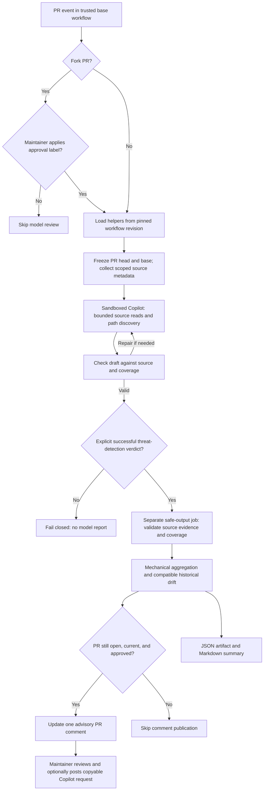

# PR slop assessment

An experimental **GitHub Agentic Workflow** for reviewing avoidable code-quality
debt in pull requests, regardless of who wrote the code.

Scores range from **0 (no supported issues found) to 100 (worst)**. They are
rubric-based indices, not percentages of AI-generated or defective code.
[SPEC.md](SPEC.md) records the approved product design.

## Pipeline



1. **Runtime** loads helpers from the same pinned revision as the reusable
   workflow. The caller does not check out or execute PR code.
2. **Inventory** queries the GitHub API using those trusted helpers. It
   freezes the PR head/base, lists changes and exclusions, validates optional CI
   evidence, and retrieves available report history. It never checks out or runs
   proposed code.
3. **Analysis** uses gh-aw's native Copilot engine.
   The judge gets only custom path-discovery, source-range, and context tools,
   with shell, editing, built-in GitHub tools, and general outbound access disabled.
   Source-byte reservations and read coverage use shared, atomic state across
   MCP subprocesses; concurrent tool calls cannot reset the one-megabyte budget.
4. **Validation** checks a draft before submission and again in a separate
   publishing job. Exact excerpts must match immutable source ranges, findings
   must overlap changed code, and reviewed modules must have been fully read.
   Missed reuse also requires a base utility and compatibility explanation.
5. **Scoring** averages available non-drift families only when at least three
   are assessable. Missing evidence is N/A, never a clean score. Compatible prior
   report artifacts provide per-family drift.
6. **Publication** rechecks the open PR head/base and updates one bot-authored report
   comment. Artifacts and summaries remain available when comments cannot be
   posted. Human-readable reports include a copyable, non-automatic Copilot
   feedback request where appropriate.

## Scoring and evidence

| Family          | What is reviewed                                                       |
| --------------- | ---------------------------------------------------------------------- |
| Redundancy      | Duplicated behaviour, compatible utilities missed, avoidable wrappers  |
| Complexity      | Changed control flow, nesting, coupling, brittleness                   |
| Maintainability | Abstractions, conventions, unnecessary dependencies                    |
| Correctness     | Supplied build, type-check, or test evidence                           |
| Reliability     | Changed error paths and trust boundaries; not a security certification |
| Revision drift  | Compatible historical score deltas, separate from the overall index    |

Category scores use only **0, 25, 50, 75, 100**, with evidence-based explanations.
Medium/low-confidence observations do not penalise scores. High-confidence
findings remain visible even if a low overall average would hide them.

Generated/vendor/binary/minified/lockfile content is excluded by default.
Tests, dependency manifests, and infrastructure-as-code are eligible.
Documentation is context. Sensitive filenames and known credential patterns
receive additional filtering; this is not a guarantee of perfect secret detection.

Deterministic mode reports eligible scope, supplied evidence, and conservative
exact eight-line duplicate candidates among up to twenty changed modules.
Candidates are **not scored**. Passing supplied execution checks can assess the
correctness family, but do not imply untested correctness. Failed checks are
reported as failures, not automatically PR-caused regressions. Without enough
assessable families there is no overall index.

## Install the reusable workflow

The reusable workflow runs as a **job**, not as a step-level action. It requires
GitHub.com Actions, runner version 2.336.0 or later, and a Copilot-enabled
account. The consuming repository must be able to access this repository and
its Actions policy must permit the referenced workflows and actions.

The reusable workflow is not part of the existing `v0.1.0` release. Once it is
released and accessible to your repository, pin it to the release's immutable
commit SHA.

### Choose authentication

| Your setup                                                                             | How to run the reusable workflow                                                                                                                                                   |
| -------------------------------------------------------------------------------------- | ---------------------------------------------------------------------------------------------------------------------------------------------------------------------------------- |
| A user has an organisation-provided Copilot seat                                       | Use that user's fine-grained PAT. Confirm the account's entitlement, usage limits and billing with your organisation.                                                              |
| Central organisation billing is unavailable, but a user has their own Copilot access   | Use that user's fine-grained PAT. Usage follows that account's plan and billing settings.                                                                                          |
| You want organisation-billed inference using the Actions `GITHUB_TOKEN`, without a PAT | **Not supported by the reusable workflow yet.** Adding `copilot-requests: write` to the caller alone does not change its compiled authentication mode.                             |
| No user has Copilot access                                                             | The reusable model workflow cannot run. The [legacy bundle](#legacy-v010-bundle) has a deterministic inventory, but it does not produce an equivalent model rating and PR comment. |

The PAT authenticates **model inference**. The workflow uses the separate,
short-lived Actions `GITHUB_TOKEN` for repository reads and the PR comment.
Never put a PAT in a workflow file, PR, or commit.

GitHub Agentic Workflows also supports
[organisation-billed inference without a PAT](https://github.github.com/gh-aw/reference/auth/#copilot-requests-write-permission)
when configured and compiled for `copilot-requests: write`. That is a different
authentication mode from this reusable workflow; it requires an eligible
organisation subscription and policy, and is not enabled by this release.

### 1. Configure the Copilot secret

1. Choose an account with Copilot access and a model available to that account.
   Check its plan, organisation policies, and usage or spending limits.
2. Create a [fine-grained personal access token](https://github.com/settings/personal-access-tokens/new?name=COPILOT_GITHUB_TOKEN&user_copilot_requests=read)
   owned by that **user account**, with **Account permissions > Copilot
   Requests: Read**. Set an appropriate expiry.
3. In the consuming repository, open **Settings > Secrets and variables >
   Actions** and add the token as `COPILOT_GITHUB_TOKEN`. Alternatively, make
   an organisation secret with that name available to the repository.
4. Rotate the secret before it expires or if the account's access changes.

See the [gh-aw authentication reference](https://github.github.com/gh-aw/reference/auth/#copilot_github_token)
for current token requirements. The model and threat-detection runs consume
Copilot usage; charges and limits depend on the account and its billing setup.

### 2. Add the caller

Create `.github/workflows/slop-assessment.yml` on the consuming repository's
trusted default branch. Replace `<RELEASE_COMMIT_SHA>` with the full SHA of a
released revision that contains the reusable workflow, and select an available
model:

```yaml
name: PR slop assessment
on:
  pull_request_target:
    types: [opened, reopened, synchronize, labeled]
permissions:
  actions: read
  checks: read
  contents: read
  issues: write
  pull-requests: write
jobs:
  assessment:
    uses: digimangos/ai-slop-assessment/.github/workflows/assess.yml@<RELEASE_COMMIT_SHA>
    with:
      model: gpt-5.3-codex
    secrets:
      COPILOT_GITHUB_TOKEN: ${{ secrets.COPILOT_GITHUB_TOKEN }}
```

The caller's permissions are the maximum available to nested jobs; retain
`checks: read` as well as the other listed permissions. Do not add steps that
check out or execute PR code in this privileged workflow. The example model
is not guaranteed to be available to every account.

### 3. Review a pull request

Open or update a same-repository PR after the caller is on the default branch.
In **Actions**, open the `PR slop assessment` run to inspect its jobs and
artifacts. A successful assessment updates one bot-authored PR comment with the
overall index, category scores, evidence, and limitations; the `slop-pr-*`
artifact contains `report.json` and `report.md`. An overall index may be N/A
when coverage or evidence is insufficient. The index is not an estimate of
AI authorship.

To review a fork PR, create and apply the `slop-review-approved` label as a
maintainer. Only the label-add event authorises a review of the current head;
remove and reapply the label after new commits.
The workflow rechecks approval and PR SHAs before commenting. This limits
untrusted contributors' ability to trigger model spending and privileged
reviews; restrict who can apply labels and protect the workflow and base
branches. `pull_request_target` runs with base-repository privileges, so never
add steps that check out or run PR code. Review GitHub's applicable event policy
before enabling it. Model output and retrieved PR text remain untrusted; gh-aw
threat detection and source-grounded validation gate publication, but cannot
guarantee immunity to prompt injection.

The workflow is experimental. Fork support has automated boundary tests but has
not yet been demonstrated with a real fork PR. Evaluate reliability in your own
environment; do not make the assessment a required merge check.

### Troubleshooting

- **Workflow cannot be found:** verify the SHA contains the reusable workflow,
  the source repository is accessible, and your Actions policy allows it.
- **Inference fails:** verify the secret is available to the caller, the PAT is
  unexpired and has Copilot Requests permission, and its owner can use the
  chosen model. Check applicable Copilot policies and usage limits.
- **No comment:** inspect the run's jobs and annotations. Unapproved fork
  events, stale PR snapshots, insufficient access, or rejected validation can
  prevent publication; a successful run alone does not guarantee a comment.
- **N/A score:** inspect the category explanations and coverage in the report.
  Missing execution evidence, for example, leaves correctness unassessed.

### Legacy v0.1.0 bundle

The existing release uses the original vendored workflow. Requires GitHub.com
Actions, Node.js 24 on the runner, and **gh-aw v1.0.1** for workflow compilation.
No production npm dependencies are needed by the helpers.

For pinned installation, use an **exact semver release** such as `v0.1.0` and
verify its archive checksum, source commit, and per-file manifest before copying.
[Release and installation instructions](docs/releases.md) explain the complete
bundle, versioning policy, and tag-triggered publishing. This is a vendored
workflow bundle, not a standalone `uses:` Action; do not pin a moving branch or
mix helpers and workflows from different releases.

The distribution consists of:

- `.github/workflows/slop-review.md` and its compiled `.lock.yml`;
- `.github/workflows/slop-inventory.yml` for the non-model/fork path;
- all `src/*.mjs` helpers, including the shared state module.

Copy those files into the adopting repository, preserving their paths. Helpers
must be on its **trusted default branch** before the assessment workflows run.
This intentionally does not bootstrap itself by executing helpers from a PR.
Before helpers are installed, inventory exits with an installation summary
instead of failing. Explicit manual inventory runs remain available even when
automatic model review is enabled.
gh-aw can install the agentic source using
`gh aw add digimangos/ai-slop-assessment/slop-review@v0.1.0`; the companion deterministic workflow
and helpers must also be copied. A workflow-only installation is not sufficient.

Initially leave `SLOP_MODEL_ENABLED` unset: only deterministic analysis runs.

To opt into model-assisted review:

1. Choose a supported Copilot model and set repository variable `SLOP_MODEL` to
   its explicit model identifier. Pinning the identifier prevents accidental
   comparisons against an unidentified changing default.
2. Configure `COPILOT_GITHUB_TOKEN` using the
   [documented gh-aw authentication setup](https://github.github.com/gh-aw/reference/auth/).
   Organisations with centralised inference billing can instead add
   `copilot-requests: write` to the Markdown frontmatter and recompile.
   The compiled default uses PAT authentication.
3. Review the workflow's inference/diagnostic data exposure and configure native
   per-run/daily credit limits in frontmatter according to the
   [cost-management reference](https://github.github.com/gh-aw/reference/cost-management/).
   No product-specific monetary budget is chosen for you; framework defaults
   still apply unless you set limits. The agent has a ten-minute job deadline and
   twelve turns, not a twelve-model-call or fixed-token guarantee.
4. Set repository variable `SLOP_MODEL_ENABLED` to `true`.

In the legacy bundle, fork PRs use the deterministic workflow and do not post
comments. That bundle deliberately **does not enable privileged model review of forks**.
An authorised fork path remains future work; do not use `pull_request_target`
to check out or execute proposed code.

Manual runs accept `pr_number` and optional `force`. The PR must be open.
Duplicate completed inputs are skipped where compatible artifact history is
available. Historical lookup is bounded to thirty recent report artifacts and
ten pages of comments; missing history leaves drift unavailable.

## Legacy bundle: optional configuration and CI results

The following variables and setup apply to the vendored legacy workflows. The
reusable workflow above does not currently expose these settings as inputs.

Set `SLOP_CONFIG_PATH` to a trusted JSON configuration file:

```json
{
  "include": ["generated/hand-maintained/**"],
  "exclude": ["fixtures/vendor/**"]
}
```

Patterns use Node's `path.matchesGlob`. Explicit exclusions win; includes can
override ordinary generated/documentation defaults, but never sensitive-file
protection. The universal scoring rubric and weights are not configurable.

Set `SLOP_EVIDENCE_PATH` to a JSON file made available to the inventory job:

```json
{
  "schema_version": 1,
  "head_sha": "aaaaaaaaaaaaaaaaaaaaaaaaaaaaaaaaaaaaaaaa",
  "base_sha": "bbbbbbbbbbbbbbbbbbbbbbbbbbbbbbbbbbbbbbbb",
  "checks": [
    {
      "name": "unit tests",
      "kind": "tests",
      "result": "failed",
      "provenance": "https://github.com/OWNER/REPOSITORY/actions/runs/123",
      "base_result": "passed",
      "base_provenance": "https://github.com/OWNER/REPOSITORY/actions/runs/122"
    }
  ]
}
```

Supported kinds are `build`, `types`, `tests`, `static-analysis`, and `security`.
Results are `passed`, `failed`, or `unavailable`. Head SHA and HTTPS provenance
are required; comparable base results also require the matching base SHA and
base provenance. Provenance is recorded, not independently attested.

High-confidence correctness findings must name a failed check (`execution_check`)
and explain its connection to the defect (`execution_relevance`). A
`regression: true` claim additionally requires comparable passing base evidence.
A zero correctness score requires every available execution check to pass;
unexplained failures leave that category N/A rather than clean.

The default PR trigger does not guess which CI workflows matter. To assess after
CI, adapt the caller/inventory job to wait for your chosen checks and download
their evidence artifact before `prepare`, or dispatch a run after supplying the
file. Do not load scripts or workflow instructions from that artifact. No
arbitrary log parsing, test execution, mutation testing, or fuzzing is performed.

## Reports and trust

Product artifacts contain `report.json` and `report.md`, with fourteen-day
retention by default (subject to repository limits and gh-aw's configured
retention override). Inventory/read-ledger artifacts have one-day retention.
Product reports never contain full prompts or transcripts. **gh-aw itself
produces diagnostic artifacts/logs**, which may include reviewed source and
engine transcripts; configure their retention and access separately. Product
artifact retention does not control all Actions logs.

Reports record assessed SHAs, model/configuration/rubric, exclusions, evidence,
coverage, and findings. Framework run metadata records inference usage separately.
Deterministic jobs expose `assessment_status`, `overall_score`, and
`assessed_families`; model publication exposes the same step outputs.
Status distinguishes complete source review, partial review, unavailable
assessment, and failed execution. Optional absent CI/history is N/A. A real
configuration/provider/validation error fails the job, not the PR's quality gate.
Do not configure the experimental assessment as a required merge check.

The publishing job receives write permission only after gh-aw's detection gate
and requires an explicit successful detection verdict before reading the draft.
The model does not. Report text escapes injected markup and mentions; feedback
requests appear in a code block for a maintainer to copy. No automatic agent
assignment, workflow approval, fix request, or merge is implemented.

## Development

```sh
npm ci --ignore-scripts
npm run check
npm test
npm run format:check
gh aw compile slop-review --no-check-update --action-mode release \
  --action-tag 0627fdbe4beb5f3b71aa569f8d97150b87f2111a
gh aw compile slop-public --no-check-update --action-mode release \
  --action-tag 0627fdbe4beb5f3b71aa569f8d97150b87f2111a
```

Commit each regenerated lock file alongside workflow edits. The runtime action
pin is the immutable gh-aw v1.0.1 commit. CI runs offline contracts and checks
compilation freshness without invoking a paid model.

This is an experimental implementation, not an evaluated production judge.
Multilingual real-model evaluation and a live fork demonstration remain
outstanding. Automated remediation remains disabled until a supported trigger
mechanism and the specification's six-ecosystem precision/stability acceptance
gates have been verified.
